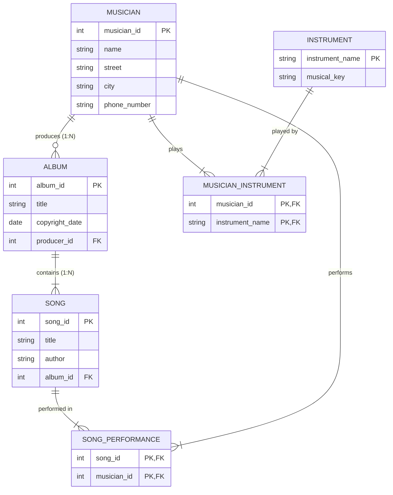

# Route - Assignment 4: Database Design & Schema Mapping

---

## 🎵 Part 1: ERD Diagram (3 Grades)

### Scenario: Musicana Records Database

### 1. Entities & Attributes:
1. **Musician**:
   - `musician_id` (PK, Unique ID number)
   - `name` (Musician name)
   - `phone_number`
   - Address: Composite attribute consisting of:
     - `street`
     - `city`
2. **Instrument**:
   - `instrument_name` (PK, Unique name)
   - `musical_key` (e.g., C, B-flat, E-flat)
3. **Album**:
   - `album_id` (PK, Unique identifier)
   - `title` (Unique title)
   - `copyright_date` (Date)
   - `producer_id` (FK referencing Musician - exactly one producer per album)
4. **Song**:
   - `song_id` (PK)
   - `title` (Unique title)
   - `author` (Song author)
   - `album_id` (FK referencing Album - each song appears on exactly one album)

---

### 2. Relationships & Cardinalities:
1. **Musician plays Instrument (M:N)**:
   - A musician may play several instruments (`0..N`).
   - An instrument may be played by several musicians (`0..N`).
   - Requires associative bridge table: `Musician_Instrument(musician_id, instrument_name)`.
2. **Musician produces Album (1:N)**:
   - Exactly one musician acts as producer for each album (`1:1`).
   - A producer may produce several albums (`0..N`).
   - Implemented via FK in Album: `Album(producer_id) -> Musician(musician_id)`.
3. **Album contains Songs (1:N)**:
   - Each album has a number of songs on it (`1..N`).
   - No song may appear on more than one album (`1:1`).
   - Implemented via FK in Song: `Song(album_id) -> Album(album_id)`.
4. **Musician performs Song (M:N)**:
   - Each song is performed by one or more musicians (`1..N`).
   - A musician may perform a number of songs (`0..N`).
   - Requires associative bridge table: `Song_Performance(song_id, musician_id)`.

---

### 3. Mermaid ERD Diagram:



---

### 4. Relational Schema Mapping (Tables):
- **`Musician`** (`musician_id` [PK], `name`, `street`, `city`, `phone_number`)
- **`Instrument`** (`instrument_name` [PK], `musical_key`)
- **`Album`** (`album_id` [PK], `title`, `copyright_date`, `producer_id` [FK -> Musician(musician_id)])
- **`Song`** (`song_id` [PK], `title`, `author`, `album_id` [FK -> Album(album_id)])
- **`Musician_Instrument`** (`musician_id` [PK, FK], `instrument_name` [PK, FK])
- **`Song_Performance`** (`song_id` [PK, FK], `musician_id` [PK, FK])

---

## 🗂️ Part 2: Design a Schema (Mapping) for the given ERD (2 Grades)

### ERD Analysis:
- **Entity 1: User**
  - Attributes: `id` (PK, underlined), `firstName`, `lastName`, `userName`, `phone`, `email`, `role`, `password`.
- **Entity 2: Product**
  - Attributes: `id` (PK, underlined), `name`, `stock`, `price`, `isDeleted`.
- **Relationship: Own**
  - Cardinality: **1 : N**
  - One `User` can own `n` `Products` (`1..N`).
  - Each `Product` is owned by one `User` (`1..1`).

---

### Schema Mapping (Relational Model):

According to relational mapping rules for a **1:N relationship**, the Primary Key of the "1" side (`User.id`) is placed as a Foreign Key into the "N" side (`Product.userId`).

#### 1. Users Table:
$$\text{Users}(\underline{\text{id}}, \text{firstName}, \text{lastName}, \text{userName}, \text{phone}, \text{email}, \text{password}, \text{role})$$

- `id`: INT, PRIMARY KEY, AUTO_INCREMENT
- `firstName`: VARCHAR(100)
- `lastName`: VARCHAR(100)
- `userName`: VARCHAR(100) UNIQUE
- `phone`: VARCHAR(20)
- `email`: VARCHAR(255) UNIQUE
- `password`: VARCHAR(255)
- `role`: VARCHAR(50)

#### 2. Products Table:
$$\text{Products}(\underline{\text{id}}, \text{name}, \text{price}, \text{stock}, \text{isDeleted}, \text{userId [FK]})$$

- `id`: INT, PRIMARY KEY, AUTO_INCREMENT
- `name`: VARCHAR(255)
- `price`: DECIMAL(10, 2)
- `stock`: INT DEFAULT 0
- `isDeleted`: BOOLEAN DEFAULT FALSE
- `userId`: INT, FOREIGN KEY REFERENCES `Users(id)` ON DELETE CASCADE

---

### SQL DDL Implementation:
```sql
CREATE TABLE Users (
    id INT AUTO_INCREMENT PRIMARY KEY,
    firstName VARCHAR(100) NOT NULL,
    lastName VARCHAR(100) NOT NULL,
    userName VARCHAR(100) NOT NULL UNIQUE,
    phone VARCHAR(20),
    email VARCHAR(255) NOT NULL UNIQUE,
    password VARCHAR(255) NOT NULL,
    role VARCHAR(50) DEFAULT 'user'
);

CREATE TABLE Products (
    id INT AUTO_INCREMENT PRIMARY KEY,
    name VARCHAR(255) NOT NULL,
    price DECIMAL(10, 2) NOT NULL,
    stock INT NOT NULL DEFAULT 0,
    isDeleted BOOLEAN NOT NULL DEFAULT FALSE,
    userId INT NOT NULL,
    FOREIGN KEY (userId) REFERENCES Users(id) ON DELETE CASCADE
);
```
